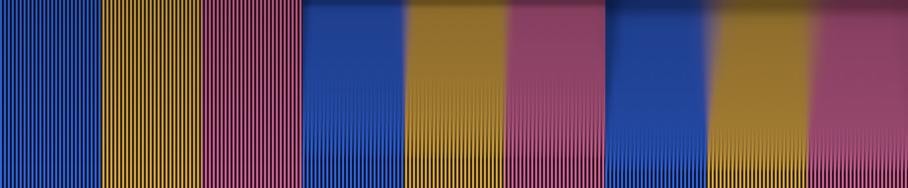

# Bruma

**Abre la tapa. Vuelve a la claridad.**

Bruma es una app nativa de macOS que desenfoca tu escritorio al mover la tapa del MacBook y lo devuelve a su nitidez al abrirla. El efecto es más intenso en el borde superior y conserva mucho más detalle cerca de la bisagra y el Dock, inspirado en las demostraciones de plegado del iPhone Duo.

Swift · AppKit · ScreenCaptureKit · Metal · Sin dependencias externas.



*Patrón generado: izquierda sin efecto, centro 35%, derecha 85%. Observa que las líneas de abajo se conservan mientras las de arriba se difuminan. No es una captura de un escritorio real.*

## Qué hace

- Lee el ángulo físico de la tapa mediante el sensor HID integrado.
- Aplica desenfoque gaussiano gradual en GPU: fuerte arriba, muy leve abajo.
- Suaviza las lecturas para que el movimiento no avance a saltos.
- Despeja el escritorio cuando dejas quieta la tapa; el retardo es configurable.
- Mantiene la imagen en su sitio por defecto, con perspectiva opcional.
- Deja pasar los clics y conserva el foco de la app que estabas usando.
- Ofrece un patrón de prueba sin permisos y una demo de seis segundos sobre tu escritorio.
- Se queda en la barra de menús y se detiene con **Control + Opción + Comando + B**.
- Solo afecta a la pantalla integrada. Se retira al bloquear, dormir o cambiar de pantallas.

## Requisitos

- macOS 14 o posterior.
- GPU compatible con Metal.
- Para seguir la tapa: un MacBook que exponga el sensor continuo de ángulo. La compatibilidad depende del modelo; ser Apple Silicon no la garantiza.
- Para compilar: Xcode con Swift 6 o posterior. En macOS 27 se recomienda Xcode completo.

La lectura del sensor se ha comprobado en un **MacBook Pro M5** con macOS 27.2.1, incluyendo el informe de centésimas de grado. Consulta [VALIDATION.md](docs/VALIDATION.md) para distinguir las pruebas realizadas de las pendientes.

## Compilar y abrir

```bash
git clone https://github.com/sergiobascon-dev/bruma.git
cd bruma
./scripts/build.sh --run
```

El resultado es `build/Bruma.app`. Después puedes abrir esa misma app desde Finder sin recompilar, o arrastrarla a Aplicaciones. La compilación no instala servicios ni modifica tus ajustes de reposo.

Para firmar con un certificado propio:

```bash
BRUMA_SIGN_IDENTITY='Apple Development: Your Name (TEAMID)' ./scripts/build.sh
```

Sin certificado se aplica una firma ad hoc. Las distribuciones de este repositorio no están notarizadas por Apple.

## Primer uso

1. Abre **Bruma.app**. La ventana muestra un patrón con líneas; mueve **Apertura simulada** para ver el gradiente sin conceder acceso a tu escritorio.
2. Pulsa **Activar en mi escritorio**. macOS puede solicitar el permiso de grabación de pantalla porque Bruma necesita leer la imagen que va a desenfocar.
3. Autoriza **Bruma** en **Ajustes del Sistema → Privacidad y seguridad → Grabación de pantalla** (el nombre puede incluir «audio del sistema» según la versión). Bruma no captura audio. Si macOS pide cerrar y reabrir, hazlo y vuelve a activar el efecto.
4. Mueve lentamente la tapa por debajo del ángulo configurado, inicialmente **110°**. Al volver a abrirla el desenfoque disminuye; al detenerla se despeja tras **1,2 s**.

Usa **Probar escritorio · 6 s** para comprobar la captura sin mover la tapa. Si no existe un sensor compatible, esta demo y el patrón simulado siguen disponibles.

Cerrar Ajustes deja la app en la barra de menús. Para detenerla, usa el menú o **⌃⌥⌘B**. **Salir de Bruma** termina el proceso.

## Controles

| Control | Resultado |
| --- | --- |
| Intensidad | Radio máximo de desenfoque, en píxeles de la imagen capturada. Cero elimina el desenfoque. |
| Conservar detalle en el Dock | Reduce el desenfoque junto a la bisagra. El gradiente sigue siempre la parte inferior, aunque hayas colocado el Dock en otro borde. |
| Empezar por debajo de | Ángulo a partir del cual aparece el efecto al mover la tapa. |
| Despejar al dejar quieta la tapa | Evita que una posición de trabajo quede desenfocada de forma permanente. |
| Perspectiva | Añade una leve recesión anclada abajo; está desactivada por defecto y se omite con Reducir movimiento. No realiza seguimiento de ojos ni corrección óptica física. |

## Privacidad

El ejecutable de Bruma no realiza peticiones de red, no incorpora analítica y no captura cámara, micrófono ni audio. Tampoco usa Accesibilidad o Monitorización de entrada. Lee únicamente el sensor de orientación seleccionado, sin escribir informes HID.

ScreenCaptureKit recibe imágenes de la pantalla integrada y excluye las ventanas de Bruma para evitar realimentación. Los fotogramas se mantienen en RAM/GPU y se liberan al terminar el efecto. La captura se detiene después de despejarse la pantalla. No se crean grabaciones, capturas de escritorio en disco ni historiales de ángulos. Solo se guardan tus controles en las preferencias locales de macOS.

Las pruebas `--render-check` sí escriben PNG, pero exclusivamente del patrón sintético generado por el programa.

## Límites conocidos

- El sensor es una interfaz HID no documentada; Apple puede cambiarla. No es una API pública garantizada de ángulo de tapa.
- No puede animar mientras el panel está apagado o macOS duerme. Al despertar, la primera imagen depende del tiempo que tarde ScreenCaptureKit en entregar un fotograma.
- Bruma se retira en la pantalla de bloqueo; no usa APIs privadas de WindowServer para dibujar allí.
- La captura funciona a un máximo solicitado de 30 fps y la capa solicita 60 fps para interpolar el efecto. Son objetivos de configuración, no una medición garantizada del rendimiento.
- Vídeo protegido por DRM puede aparecer negro. La salida del efecto es SDR sRGB; no conserva la luminancia HDR.
- Recompilar una app con firma ad hoc puede invalidar el permiso de captura. Si deja de funcionar, cierra Bruma, elimina únicamente su entrada de Grabación de pantalla, añade la app final otra vez y vuelve a abrirla.
- El atajo puede estar ocupado por otra app. El menú de Bruma siempre permite detener el efecto.
- No se añade automáticamente al inicio de sesión.

## Desarrollo y comprobaciones

```bash
./scripts/check.sh
./build/Bruma.app/Contents/MacOS/Bruma --diagnose
./build/Bruma.app/Contents/MacOS/Bruma --render-check build/render-check
```

Los tests comprueban el sentido apertura/cierre, el despejado al detenerse, el ruido del sensor, movimientos lentos, datos inválidos y la pérdida de pantalla. La comprobación GPU valida que la imagen abierta sea idéntica al original, que arriba se pierda más detalle que abajo, que la intensidad cero funcione y que el resultado sea opaco.

La CI compila la app y ejecuta los tests de política; las pruebas GPU deben ejecutarse en un Mac con GPU accesible.

| Archivo | Función |
| --- | --- |
| `Sources/BrumaCore/EffectPolicy.swift` | Estado de movimiento y curva de desenfoque. |
| `Sources/Bruma/LidSensor.swift` | Lectura HID de la tapa. |
| `Sources/Bruma/ScreenCapture.swift` | Captura temporal del escritorio. |
| `Sources/Bruma/Renderer.swift` y `Frost.metal` | Pirámide gaussiana y gradiente en Metal. |
| `Sources/Bruma/Overlay.swift` | Capa que deja pasar clics. |
| `Sources/Bruma/App.swift` | Menú, permisos, atajo y ciclo de vida. |
| `Sources/Bruma/SettingsWindow.swift` | Ajustes nativos y patrón de prueba. |

## Investigación y créditos

Bruma es una implementación independiente creada con asistencia de Codex. Se estudiaron proyectos públicos antes de escribirla. No incluye su código, sus binarios, sus iconos ni sus vídeos. [El análisis técnico](docs/RESEARCH.md) explica qué se encontró y qué se decidió implementar.

- [Sam Henri Gold · LidAngleSensor](https://github.com/samhenrigold/LidAngleSensor): documentación práctica del sensor HID.
- [Makito · Mac Duo](https://github.com/sumimakito/Mac-Duo): referencia de captura en vivo, exclusión de la capa y desenfoque gaussiano progresivo.
- [lqSky7 · macTilt](https://github.com/lqSky7/iphone-duo-macos-animation): referencia del gradiente hacia la bisagra y del efecto de apertura/cierre.
- [Jhey · Lid Plane](https://github.com/jh3y/lid-plane): referencia visual y de comportamiento al detener la tapa.
- [Bendy](https://trybendy.app): una de las demos difundidas de este efecto; su código no se estudió ni se incorpora.

Bruma no está afiliada a Apple ni a esos proyectos. Licencia [MIT](LICENSE).
